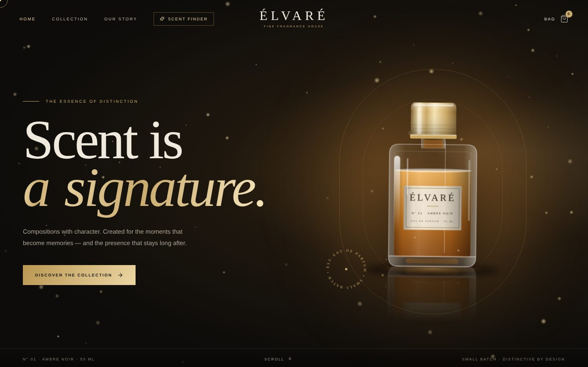
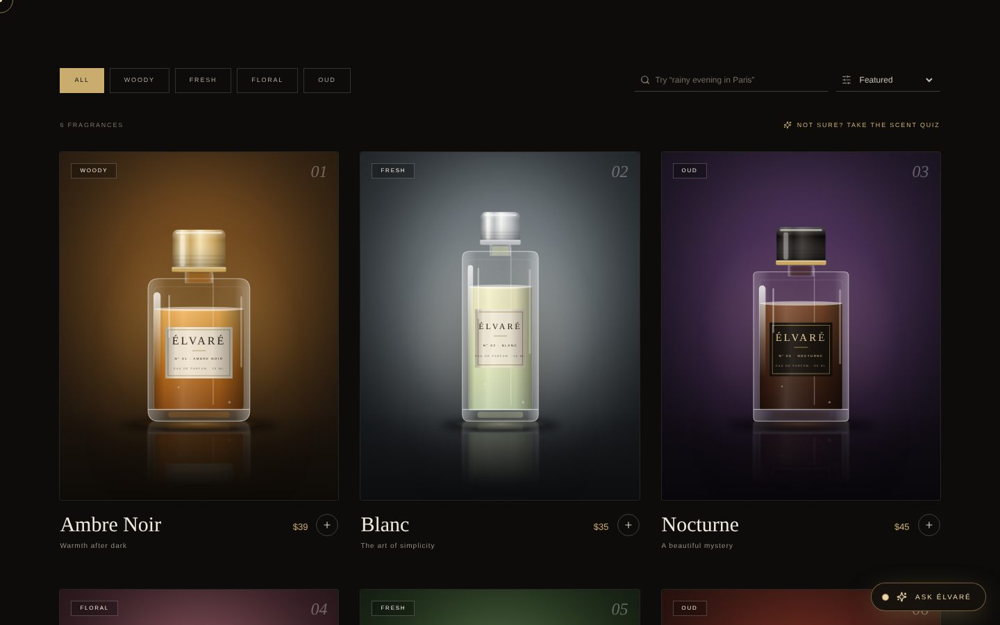
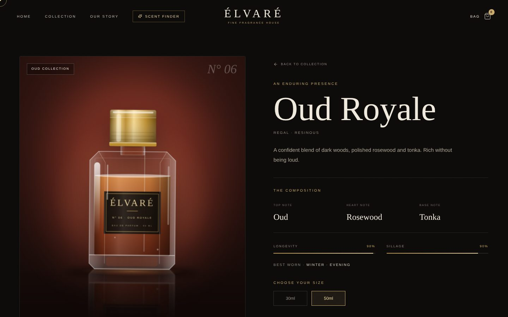
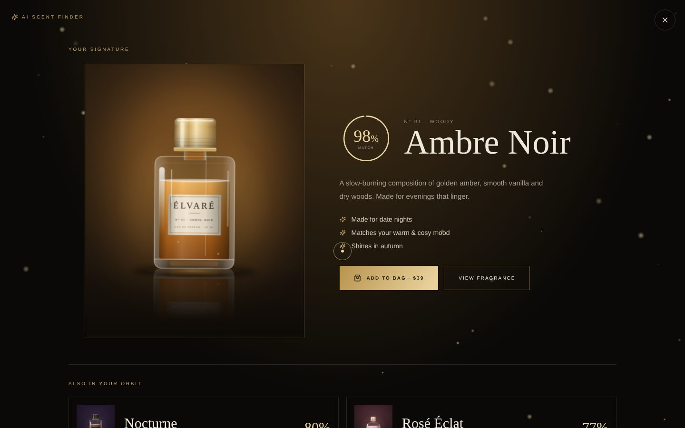

<div align="center">

# ÉLVARÉ — Fine Fragrance Storefront

**A luxury, animated e-commerce concept with an AI scent concierge.**
Hand-built with React, GSAP and Lenis. Every perfume bottle is rendered in code.

[**Live demo →**](https://elvare.vercel.app) &nbsp;·&nbsp; React 19 · Vite · Tailwind CSS 4 · GSAP · Motion · Groq



</div>

> **Concept project.** ÉLVARÉ is a fictional fragrance house created as a portfolio piece. Products, prices, reviews and checkout are illustrative only.

## Highlights

- **Cinematic first impression:** animated preloader, split-text hero, mouse-parallax bottle, drifting gold dust and film grain.
- **Buttery interactions:** Lenis smooth scrolling, GSAP ScrollTrigger parallax, a pinned "scent journey" section where the liquid level rises as you scroll, magnetic buttons and a custom cursor.
- **Realistic bottles without a single image file:** each fragrance is a procedurally drawn SVG with glass thickness, tinted liquid, label, machined metal cap, light sweep and floor reflection. Fast, sharp at any size and never a broken image.
- **Full shopping flow:** collection with animated filters, search and sorting, product pages with longevity/sillage meters, cart drawer with free-shipping progress, persistent cart (localStorage).
- **AI features** (see below).
- Responsive from phone to ultrawide, keyboard-accessible, respects `prefers-reduced-motion`.

| Collection | Product page |
|---|---|
|  |  |

## AI features

| Feature | How it works |
|---|---|
| **AI Scent Finder** | Five-question quiz. Answers are scored against a weighted taste profile for every fragrance, producing a match percentage and the reasons behind it. |
| **Mood search** | Type *"cozy rainy evening"* in the shop and results are re-ranked by mood. Understands English and Roman Urdu keywords. |
| **Layering suggestions** | Each product page suggests pairings with a short explanation. |
| **Ask ÉLVARÉ concierge** | A chat assistant powered by an LLM (Groq, streamed token by token). It only recommends products from the catalogue and replies in the customer's language. |



**Under the hood**

- The scent finder, mood search and pairings run **entirely in the browser** (`src/lib/scentAI.js`): no API, no cost, deterministic results.
- The concierge is **hybrid**: the local engine instantly produces product cards while the LLM streams the written answer. If the LLM is unavailable (no key, offline, rate-limited or slow) the chat silently falls back to the local engine, so the site never breaks.
- The API key lives **only on the server** (`api/chat.js`, a Vercel Edge Function). The browser never sees it.

## Tech stack

React 19 · React Router 7 · Vite 7 · Tailwind CSS 4 · GSAP + ScrollTrigger · Lenis · Motion (Framer Motion) · Lucide icons · Groq API (via Vercel Edge Function)

## Getting started

```bash
git clone https://github.com/nouman-0886/elvare.git
cd elvare
npm install
cp .env.example .env      # then add your Groq key (optional)
npm run dev
```

Without a key the site works fully; the chat uses the built-in local engine.

### Environment variables

| Name | Required | Description |
|---|---|---|
| `GROQ_API_KEY` | optional | Free key from [console.groq.com](https://console.groq.com). Enables the LLM-powered concierge. |
| `GROQ_MODEL` | optional | Groq chat model id. Defaults to `openai/gpt-oss-20b`. |

> Never commit `.env`. It is already listed in `.gitignore`. Do **not** prefix the key with `VITE_`, as that would expose it in the browser.

## Deploy to Vercel

1. Push this repository to GitHub.
2. In Vercel choose **Add New → Project** and import the repo (Vite is detected automatically).
3. Add `GROQ_API_KEY` under **Settings → Environment Variables**, then deploy.

`vercel.json` makes client-side routes such as `/shop` work on refresh. For local testing of the serverless function, `npm run dev` already serves `/api/chat` through a small Vite middleware.

## Project structure

```
api/chat.js            Edge function: streams Groq replies, key stays server-side
src/
  components/          Bottle (SVG renderer), Stage, ScentFinder, Concierge, Navbar, Cart…
  context/             Cart and UI state
  data/products.js     Catalogue + per-product bottle design
  lib/                 scentAI (matching engine), llm (stream client), scroll (Lenis + GSAP)
  pages/               Home, Shop, ProductDetails
```

## Notes

- The one lifestyle photo in the story section loads from Unsplash and falls back gracefully if unavailable. Fonts (Cormorant Garamond, DM Sans) load from Google Fonts.
- Checkout and the newsletter form are demo-only and do not process any data.

## Author

**Muhammad Nouman Ijaz** — front-end developer & creative designer, Bahawalpur, Pakistan.
[LinkedIn](https://linkedin.com/in/nouman-webdev)
